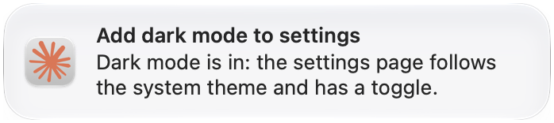
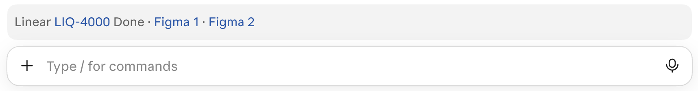

# Claude plugins

Claude Code plugins for the [Claude desktop app](https://claude.com/download). Not affiliated with
Anthropic.

## session-banners

A macOS banner when a session in the Claude desktop app finishes, with the session's title and the
first line of Claude's reply. One click opens that exact session, however many you have running.
It stays quiet while you are in the Claude app. Its small helper app also shows pr-watch's banners.
[More](plugins/session-banners)



## status-bar

A row of links above the message box, next to the pull request the app already shows:

- the session's Linear ticket, its state and the Figma frames it links
- the open pull request's preview links, or `Preview deploying` and `Preview failed` with the run
- after the merge, how far the change has shipped: `on dev`, `on qa` or `on prod`

It finds the ticket in the pull request title, the branch name or the first Linear link you sent.
[More](plugins/status-bar)



## pr-watch

A macOS banner and a dim note in the session when the session's pull request is approved, turns
ready to merge, leaves the merge queue, merges or closes, and when each deploy stage succeeds or
fails. Nothing is sent in your name and no reply starts. [More](plugins/pr-watch)


**Screenshot missing: the note in the session.**

## worktree-warmup

When a session opens in a new or reused worktree whose install is missing or stale, it installs the
dependencies in the background and shows its progress above the message box, ending with
`Worktree ready` or a failure with a Retry button. Claude's commands that need the dependencies
wait for it. [More](plugins/worktree-warmup)

**Screenshot missing: the progress row above the message box.**

## Install

Add the marketplace once, then install the plugins you want:

```bash
claude plugin marketplace add IgorKrupenja/claude-plugins
claude plugin install session-banners@igor-plugins
claude plugin install status-bar@igor-plugins
claude plugin install pr-watch@igor-plugins
claude plugin install worktree-warmup@igor-plugins
```

Or run `/plugin marketplace add IgorKrupenja/claude-plugins` and then
`/plugin install <plugin>@igor-plugins` in a Claude Code session. Each plugin's README covers its
requirements and settings.

## Update

```bash
claude plugin marketplace update igor-plugins
```
