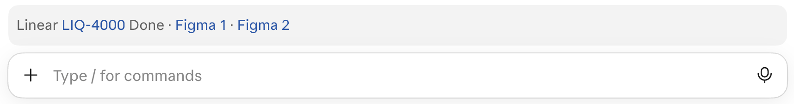
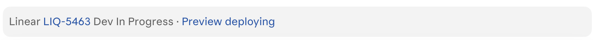

# status-bar

The Claude desktop app shows each session's pull request. This plugin adds what the app can't
know: the session's Linear ticket, its state, its designs, the pull request's preview and how
far the change has shipped, in a `Linear LIQ-123 In Review · Figma · Preview · Admin` row above
the message box, in every session that works on a ticket.





`Preview deploying` opens the preview's deploy run on GitHub.

- **Read from what you already write:** the ticket IDs come from the title of the pull request
  the app shows for the session (`feat(api): LIQ-123: ...`, several IDs work too), then the
  current branch's pull request, then the branch name (`liq-123-...`), then the first Linear link
  you sent in the session, so a new session shows its ticket before any branch or pull request
  names it. A worktree on a detached HEAD still gets its link from the session's pull request.
- **The design one click away:** with a Linear API key, every Figma frame the ticket links, in
  its description or as an attachment, gets its own `Figma` link next to the ticket, after the
  ticket's state (`In Review`, `QA`, `Done`).
- **The preview, live:** while the pull request is open, its preview links show once the
  newest preview workflow run succeeded, `Preview deploying` links the run while it goes (checked
  every minute), and `Preview failed` links the run that broke. A preview past its lifetime, or
  torn down, drops off.
- **Where it has shipped:** once the pull request merges, `on dev`, `on qa` or `on prod` says the
  furthest deploy branch its merge commit has reached, checked every ten minutes.
- **The exact ticket page:** the link is the Linear URL the pull request body carries, the
  ticket's own URL from Linear, or `linear.app/<workspace>/issue/<id>`.
- **Keeps up by itself:** it checks again after every turn, so a new branch or a new pull request
  shows up without a restart.

## Requirements

- `git` and the [GitHub CLI](https://cli.github.com) (`gh`), signed in, to read the pull request
- A session started in a git checkout, such as a worktree session

## Install

```bash
claude plugin marketplace add IgorKrupenja/claude-plugins
claude plugin install status-bar@igor-plugins
```

## Settings

Both are optional. Set them with `/plugin configure status-bar@igor-plugins` in Claude Code, or
pipe a JSON object to `claude plugin configure status-bar@igor-plugins --values-stdin`.

- `linearApiKey`: a personal API key from Linear (Settings > Security & access), for the Figma
  links and each ticket's exact URL. It is kept in secure storage, never in `settings.json`.
  Without it the plugin also reads a `LINEAR_API_KEY` environment variable.
- `workspace`: your Linear workspace's URL key, the `acme` in `linear.app/acme/issue/ACME-1`, for
  a branch that has no pull request yet when no API key is set.
- `stages`: the branches a merged pull request moves through, in order, as `branch=label` pairs,
  such as `main=dev, qa=qa, prod=prod`. Empty, the default, hides the deploy stage.
- `previewWorkflow` and `previewLinks`: the workflow file that deploys a pull request's preview,
  such as `pr-preview.yml`, and its links as `label=URL` pairs with `{number}` for the pull
  request number, such as `Preview=https://pr-{number}.preview.example.com`. Both empty, the
  default, hides the preview.
- `previewIdleHours`: how long after its last deploy a preview is torn down, 48 by default.

For banners when the pull request is approved, merges or deploys, see [pr-watch](../pr-watch).


## Develop

```bash
claude plugin validate plugins/status-bar
claude plugin test plugins/status-bar
```
